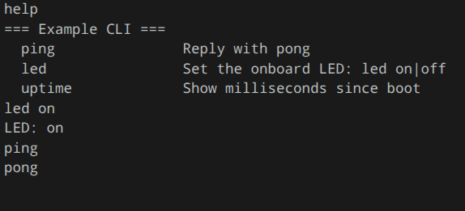

# SerialCLI

A running firmware is a black box. SerialCLI gives you a serial command line to inspect its state and change its behaviour while it runs.

## What you get

- Register case-insensitive commands to read state, change settings and trigger actions at runtime.
- Generated `help` output from the command table, with a title per project.
- No UART dependency and no heap allocation; buffers and the command table are compile-time sized.

## Usage

The [`example-project`](example-project/src/main.cpp) sketch shows the full setup on a seeed_xiao_esp32c5: output callback, three commands and the feed loop.

## Testing

Run `make test` to build and run the host tests with the system C++ compiler.

## License

